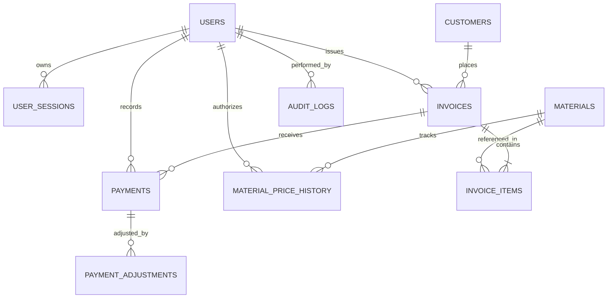

# Database Design Specification

## Project: NPR Metal Crusher — Billing & Management System

---

## 1. Overview & Conventions
- **Database Engine:** PostgreSQL 15+ (Hosted on Supabase South Asia / Mumbai).
- **Driver:** `pg` (node-postgres) via connection pool (`pg.Pool`).
- **Migration Location:** `database/migrations/` (versioned sequential SQL files).
- **Naming Conventions:** `snake_case` for tables and columns; uppercase for SQL keywords.
- **Monetary Types:** `NUMERIC(12, 2)` for currency (LKR).
- **Measurement Types:** `NUMERIC(10, 3)` for cubic meters (m³).
- **Timestamps:** `TIMESTAMPTZ` (UTC storage, rendered in `Asia/Colombo`).

---

## 2. Entity-Relationship Model



---

## 3. Detailed Table Specifications

### 3.1 `users` (System Accounts)
```sql
CREATE TABLE users (
    id UUID PRIMARY KEY DEFAULT gen_random_uuid(),
    username VARCHAR(50) UNIQUE NOT NULL,
    password_hash VARCHAR(255) NOT NULL,
    full_name VARCHAR(100) NOT NULL,
    role VARCHAR(20) NOT NULL CHECK (role IN ('OWNER', 'CASHIER')),
    is_active BOOLEAN NOT NULL DEFAULT true,
    created_at TIMESTAMPTZ NOT NULL DEFAULT NOW(),
    updated_at TIMESTAMPTZ NOT NULL DEFAULT NOW()
);
```

### 3.2 `user_sessions` (Hashed Session Store)
```sql
CREATE TABLE user_sessions (
    id UUID PRIMARY KEY DEFAULT gen_random_uuid(),
    token_hash VARCHAR(64) UNIQUE NOT NULL, -- SHA-256 hash of raw session token
    user_id UUID NOT NULL REFERENCES users(id) ON DELETE CASCADE,
    ip_address VARCHAR(45),
    user_agent TEXT,
    expires_at TIMESTAMPTZ NOT NULL,
    created_at TIMESTAMPTZ NOT NULL DEFAULT NOW()
);
CREATE INDEX idx_user_sessions_token_hash ON user_sessions(token_hash);
CREATE INDEX idx_user_sessions_expires_at ON user_sessions(expires_at);
```

### 3.3 `materials` (Catalog & Active Prices)
```sql
CREATE TABLE materials (
    id SERIAL PRIMARY KEY,
    code VARCHAR(20) UNIQUE NOT NULL, -- e.g., 'M_3_4', 'M_DUST', 'M_6_9', 'M_ABC'
    name VARCHAR(100) NOT NULL,       -- e.g., '3/4" Aggregate', 'Dust', '6×9 Aggregate', 'ABC'
    unit VARCHAR(10) NOT NULL DEFAULT 'm³',
    current_unit_price NUMERIC(12, 2) NOT NULL CHECK (current_unit_price >= 0),
    is_active BOOLEAN NOT NULL DEFAULT true,
    created_at TIMESTAMPTZ NOT NULL DEFAULT NOW(),
    updated_at TIMESTAMPTZ NOT NULL DEFAULT NOW()
);
```

### 3.4 `material_price_history` (Price Governance Audit)
```sql
CREATE TABLE material_price_history (
    id BIGSERIAL PRIMARY KEY,
    material_id INT NOT NULL REFERENCES materials(id) ON DELETE RESTRICT,
    old_price NUMERIC(12, 2) NOT NULL,
    new_price NUMERIC(12, 2) NOT NULL,
    changed_by_user_id UUID NOT NULL REFERENCES users(id) ON DELETE RESTRICT,
    reason TEXT,
    created_at TIMESTAMPTZ NOT NULL DEFAULT NOW()
);
CREATE INDEX idx_price_history_material ON material_price_history(material_id);
```

### 3.5 `customers` (Directory & Contacts)
```sql
CREATE TABLE customers (
    id BIGSERIAL PRIMARY KEY,
    name VARCHAR(150) NOT NULL,
    phone VARCHAR(20) NOT NULL,
    location VARCHAR(255) NOT NULL,
    notes TEXT,
    created_at TIMESTAMPTZ NOT NULL DEFAULT NOW(),
    updated_at TIMESTAMPTZ NOT NULL DEFAULT NOW()
);
CREATE INDEX idx_customers_phone ON customers(phone);
CREATE INDEX idx_customers_name ON customers(name);
```

### 3.6 `invoices` (Sales Contract Ledger)
```sql
CREATE TABLE invoices (
    id BIGSERIAL PRIMARY KEY,
    invoice_number VARCHAR(30) UNIQUE NOT NULL, -- e.g., 'NPR-INV-2026-00001'
    customer_id BIGINT NOT NULL REFERENCES customers(id) ON DELETE RESTRICT,
    -- Immutable historical snapshots:
    customer_name_snapshot VARCHAR(150) NOT NULL,
    customer_phone_snapshot VARCHAR(20) NOT NULL,
    customer_location_snapshot VARCHAR(255) NOT NULL,
    has_transport BOOLEAN NOT NULL DEFAULT false,
    transport_fee NUMERIC(12, 2) NOT NULL DEFAULT 0.00 CHECK (transport_fee >= 0),
    subtotal NUMERIC(12, 2) NOT NULL CHECK (subtotal >= 0),
    grand_total NUMERIC(12, 2) NOT NULL CHECK (grand_total >= 0),
    paid_amount NUMERIC(12, 2) NOT NULL DEFAULT 0.00 CHECK (paid_amount >= 0),
    balance_amount NUMERIC(12, 2) NOT NULL CHECK (balance_amount >= 0),
    payment_status VARCHAR(20) NOT NULL CHECK (payment_status IN ('UNPAID', 'PARTIALLY_PAID', 'PAID')),
    issued_by_user_id UUID NOT NULL REFERENCES users(id) ON DELETE RESTRICT,
    issued_at TIMESTAMPTZ NOT NULL DEFAULT NOW(),
    created_at TIMESTAMPTZ NOT NULL DEFAULT NOW(),
    -- Financial Invariant Checks:
    CONSTRAINT chk_total_balance CHECK (paid_amount + balance_amount = grand_total),
    CONSTRAINT chk_grand_total CHECK (grand_total = subtotal + transport_fee),
    CONSTRAINT chk_transport_consistency CHECK (has_transport = true OR transport_fee = 0.00)
);
CREATE INDEX idx_invoices_number ON invoices(invoice_number);
CREATE INDEX idx_invoices_customer ON invoices(customer_id);
CREATE INDEX idx_invoices_status ON invoices(payment_status);
CREATE INDEX idx_invoices_issued_at ON invoices(issued_at);
```

### 3.7 `invoice_items` (Frozen Itemization)
```sql
CREATE TABLE invoice_items (
    id BIGSERIAL PRIMARY KEY,
    invoice_id BIGINT NOT NULL REFERENCES invoices(id) ON DELETE RESTRICT,
    material_id INT NOT NULL REFERENCES materials(id) ON DELETE RESTRICT,
    material_name_snapshot VARCHAR(100) NOT NULL,
    quantity NUMERIC(10, 3) NOT NULL CHECK (quantity > 0),
    unit_price NUMERIC(12, 2) NOT NULL CHECK (unit_price >= 0),
    line_total NUMERIC(12, 2) NOT NULL CHECK (line_total = ROUND(quantity * unit_price, 2))
);
CREATE INDEX idx_invoice_items_invoice ON invoice_items(invoice_id);
```

### 3.8 `payments` (Append-Only Cash Ledger)
```sql
CREATE TABLE payments (
    id BIGSERIAL PRIMARY KEY,
    receipt_number VARCHAR(30) UNIQUE NOT NULL, -- e.g., 'NPR-REC-2026-00001'
    invoice_id BIGINT NOT NULL REFERENCES invoices(id) ON DELETE RESTRICT,
    cashier_user_id UUID NOT NULL REFERENCES users(id) ON DELETE RESTRICT,
    amount NUMERIC(12, 2) NOT NULL CHECK (amount > 0),
    payment_method VARCHAR(20) NOT NULL DEFAULT 'CASH' CHECK (payment_method = 'CASH'),
    idempotency_key VARCHAR(64) UNIQUE NOT NULL,
    notes TEXT,
    created_at TIMESTAMPTZ NOT NULL DEFAULT NOW()
);
CREATE INDEX idx_payments_invoice ON payments(invoice_id);
CREATE INDEX idx_payments_cashier ON payments(cashier_user_id);
CREATE INDEX idx_payments_created_at ON payments(created_at);
```

### 3.9 `payment_adjustments` (Auditable Owner Corrections)
```sql
CREATE TABLE payment_adjustments (
    id BIGSERIAL PRIMARY KEY,
    payment_id BIGINT NOT NULL REFERENCES payments(id) ON DELETE RESTRICT,
    authorized_by_owner_id UUID NOT NULL REFERENCES users(id) ON DELETE RESTRICT,
    adjustment_type VARCHAR(20) NOT NULL CHECK (adjustment_type IN ('VOID', 'CORRECTION')),
    adjustment_amount NUMERIC(12, 2) NOT NULL,
    reason TEXT NOT NULL CHECK (length(trim(reason)) >= 10),
    created_at TIMESTAMPTZ NOT NULL DEFAULT NOW()
);
CREATE INDEX idx_adjustments_payment ON payment_adjustments(payment_id);
```

### 3.10 `audit_logs` (System Security & Change Journal)
```sql
CREATE TABLE audit_logs (
    id BIGSERIAL PRIMARY KEY,
    user_id UUID REFERENCES users(id) ON DELETE SET NULL,
    action VARCHAR(50) NOT NULL,
    entity_type VARCHAR(50) NOT NULL,
    entity_id VARCHAR(50) NOT NULL,
    details JSONB NOT NULL,
    ip_address VARCHAR(45),
    created_at TIMESTAMPTZ NOT NULL DEFAULT NOW()
);
CREATE INDEX idx_audit_logs_user ON audit_logs(user_id);
CREATE INDEX idx_audit_logs_entity ON audit_logs(entity_type, entity_id);
CREATE INDEX idx_audit_logs_created_at ON audit_logs(created_at);
```

---

## 4. Analytical Views

### 4.1 Authoritative Invoice Ledger View
```sql
CREATE VIEW invoice_ledger_view AS
SELECT
    i.id AS invoice_id,
    i.invoice_number,
    i.customer_name_snapshot,
    i.customer_phone_snapshot,
    i.grand_total,
    COALESCE(SUM(p.amount), 0.00) AS total_paid_ledger,
    (i.grand_total - COALESCE(SUM(p.amount), 0.00)) AS balance_due_ledger,
    CASE
        WHEN COALESCE(SUM(p.amount), 0.00) = 0 THEN 'UNPAID'
        WHEN COALESCE(SUM(p.amount), 0.00) >= i.grand_total THEN 'PAID'
        ELSE 'PARTIALLY_PAID'
    END AS status_ledger,
    i.issued_at
FROM invoices i
LEFT JOIN payments p ON p.invoice_id = i.id
GROUP BY i.id;
```

### 4.2 Cashier Shift Reconciliation View
```sql
CREATE VIEW cashier_shift_reconciliation_view AS
SELECT
    p.cashier_user_id,
    u.full_name AS cashier_name,
    DATE(p.created_at AT TIME ZONE 'Asia/Colombo') AS shift_date,
    COUNT(p.id) AS total_receipts,
    SUM(p.amount) AS total_cash_collected
FROM payments p
JOIN users u ON u.id = p.cashier_user_id
GROUP BY p.cashier_user_id, u.full_name, DATE(p.created_at AT TIME ZONE 'Asia/Colombo');
```

---

## 5. Triggers for Permanent Immutability

```sql
CREATE OR REPLACE FUNCTION enforce_invoice_immutability()
RETURNS TRIGGER AS $$
BEGIN
    IF (OLD.invoice_number <> NEW.invoice_number OR
        OLD.subtotal <> NEW.subtotal OR
        OLD.transport_fee <> NEW.transport_fee OR
        OLD.grand_total <> NEW.grand_total OR
        OLD.issued_at <> NEW.issued_at OR
        OLD.issued_by_user_id <> NEW.issued_by_user_id) THEN
        RAISE EXCEPTION 'Issued invoice commercial details are permanently immutable';
    END IF;
    RETURN NEW;
END;
$$ LANGUAGE plpgsql;

CREATE TRIGGER trg_invoice_immutability
BEFORE UPDATE ON invoices
FOR EACH ROW EXECUTE FUNCTION enforce_invoice_immutability();

CREATE OR REPLACE FUNCTION forbid_line_item_modifications()
RETURNS TRIGGER AS $$
BEGIN
    RAISE EXCEPTION 'Invoice line items are permanently immutable once created';
END;
$$ LANGUAGE plpgsql;

CREATE TRIGGER trg_invoice_items_lock
BEFORE UPDATE OR DELETE ON invoice_items
FOR EACH ROW EXECUTE FUNCTION forbid_line_item_modifications();
```
