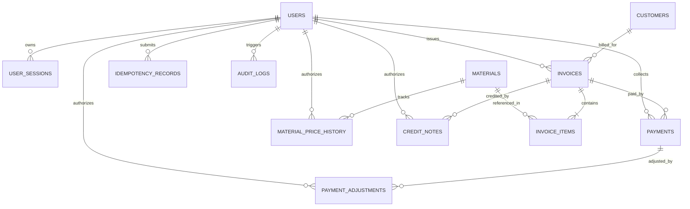

# Database Design & Migration Specification

## Project: NPR Metal Crusher — Billing & Management System

---

## 1. Overview & Conventions
- **Database Engine:** PostgreSQL 15+ (Hosted on Supabase South Asia / Mumbai).
- **Driver:** `pg` (node-postgres) via connection pool (`pg.Pool`).
- **Migration Tool:** `node-pg-migrate` (v9.x) configured in `backend/package.json`.
- **Migration Location:** `database/migrations/` (forward-only, transactional SQL files).
- **Naming Conventions:** `snake_case` for tables and columns; uppercase for SQL keywords.
- **Monetary Precision:** `NUMERIC(12, 2)` for LKR currency.
- **Measurement Precision:** `NUMERIC(10, 3)` for cubic meters (m³).
- **Timestamps:** `TIMESTAMPTZ` (UTC storage, evaluated in `Asia/Colombo` for daily reports).

### Provisional Business Decisions (Pending Client Confirmation)
1. **Continuous Numbering Without Annual Resets:** Document prefixes (`NPR-INV-`, `NPR-REC-`, `NPR-ADJ-`, `NPR-CRN-`) use continuous PostgreSQL sequences without annual reset logic.
2. **Sequence Gap Tolerance:** Standard PostgreSQL sequences guarantee non-blocking uniqueness, not gapless numbering (rolled-back transactions consume sequence values).
3. **Non-Unique Customer Phone Numbers:** Indexed for fast duplicate search and cashier warnings, allowing multiple contractors or sites to share a company phone.
4. **Deferred Seed Data:** Initial accounts (1 Owner, 2 Cashiers) and catalog prices (3/4", Dust, 6×9, ABC) will be seeded separately in Phase 3 without committing secrets or invented prices.

---

## 2. Entity-Relationship Model

---

## 3. Invoice Issuance Lifecycle & Immutability

To allow multi-row insertion within an atomic transaction while guaranteeing that no finalized invoice can ever receive additional items or commercial edits:

1. **Enter Transaction (`DRAFT` Initialization):**
   `INSERT INTO invoices (..., status = 'DRAFT', subtotal = 0.00, issued_at = NULL)`.
   A `BEFORE INSERT` trigger blocks creating any new invoice directly in `'ISSUED'` or `'CANCELLED'` status.
2. **Insert Frozen Line Items:**
   `INSERT INTO invoice_items (...)` succeeds *only* while `invoices.status = 'DRAFT'`.
3. **Finalize Invoice (`DRAFT` -> `ISSUED`):**
   `UPDATE invoices SET subtotal = <sum>, grand_total = <sum + transport_fee>, status = 'ISSUED', issued_at = NOW()`.
   The `BEFORE UPDATE` trigger verifies `COUNT(invoice_items) > 0` and exact agreement between `subtotal` and `SUM(line_total)`.
4. **Commit Guard (`DEFERRABLE INITIALLY DEFERRED`):**
   An `AFTER INSERT OR UPDATE` constraint trigger executes at `COMMIT`. If any invoice remains in `'DRAFT'` status at commit time, PostgreSQL aborts and rolls back the entire transaction. Incomplete drafts can **never** persist in the database.
5. **Post-Issuance Lock:**
   Once `'ISSUED'`, `invoice_items` rejects all `INSERT`, `UPDATE`, and `DELETE` operations unconditionally, and `invoices` rejects all commercial updates and all `DELETE` operations.

---

## 4. Authoritative Financial Ledger & Correction Accounting

All financial balances are **derived dynamically** from the append-only ledgers in `invoice_ledger_view`:

- **Effective Commercial Liability:** `invoices.grand_total - SUM(credit_notes.credit_amount)`
- **Gross Recorded Receipts:** `SUM(payments.amount)`
- **Clerical Entry Reversals:** `SUM(payment_adjustments.adjustment_amount) WHERE adjustment_type = 'ENTRY_REVERSAL'` (non-cash bookkeeping corrections)
- **Actual Cash Refunds:** `SUM(payment_adjustments.adjustment_amount) WHERE adjustment_type = 'CASH_REFUND'` (physical LKR payouts attributed to `performed_by_user_id`)
- **Corrected Net Receipts:** `gross_recorded_receipts - entry_reversals_amount`
- **Physical Cash Movement:** `gross_recorded_receipts - cash_refunded_amount` (actual cash collected vs. cash physically paid out)
- **Effective Paid Amount (Net Effective Cash):** `gross_recorded_receipts - entry_reversals_amount - cash_refunded_amount`
- **Signed Balance:** `effective_grand_total - effective_paid` (never masked by clamping negative values to zero; negative values surface as `refund_due_to_customer` and `REFUND_DUE`)

| Event Type | `effective_grand_total` | `effective_paid` | `gross_recorded_receipts` | `entry_reversals` | `cash_refunded` | `physical_cash_movement` | `balance_due` |
|---|---|---|---|---|---|---|---|
| **Cash Payment (`payments`)** | Unchanged | `+ amount` | `+ amount` *(receipt date)* | `0` | `0` | `+ amount` | `- amount` |
| **Entry Reversal (`ENTRY_REVERSAL`)** | Unchanged | `- amount` | Unchanged | `+ amount` *(reversal date)* | `0` *(no payout)* | `0` *(bookkeeping only)* | `+ amount` |
| **Cash Refund (`CASH_REFUND`)** | Unchanged | `- amount` | Unchanged | `0` | `+ amount` *(refund date)* | `- amount` *(performer's drawer)* | `+ amount` / reduces `refund_due` |
| **Credit Note (`credit_notes`)** | `- credit` | Unchanged | `0` | `0` | `0` *(not proof of payout)* | `0` | `- credit` *(or `REFUND_DUE`)* |
| **Invoice Cancellation** | `0.00` | Unchanged unless refunded | `0` | `0` | `0` unless `CASH_REFUND` | `0` | `0.00` or `REFUND_DUE` |

### Daily & Per-User Cash Reconciliation Safety
- `daily_cash_reconciliation_view` and `cashier_shift_reconciliation_view` **pre-aggregate** receipts, entry reversals, and physical cash refunds independently before joining on a unified date/user key spine (`UNION` + `LEFT JOIN`).
- Multiple adjustments to one payment never multiply `gross_recorded_receipts`.
- **Refund Actor Attribution:** `payment_adjustments` distinguishes `authorized_by_owner_id` (Owner approval) from `performed_by_user_id` (actor handing cash out of drawer). `cashier_shift_reconciliation_view` attributes `CASH_REFUND` payouts strictly to `performed_by_user_id`, never deducting from the original receipt cashier if a different cashier or Owner paid out the refund.

---

## 5. Migration Tooling & Safe Execution Commands

Migrations live exclusively under `database/migrations/` and are managed via `node-pg-migrate` scripts defined in `backend/package.json`:

| Command (from `backend/`) | Purpose | Database Impact |
|---|---|---|
| `npm run migrate:check` | Offline validation of `.sql` filenames, headers, indexes & triggers | None (filesystem only) |
| `npm run migrate:status` | Read-only check comparing local migrations against `public.pgmigrations` | Read-only `SELECT` |
| `npm run migrate:dry-run` | Prints migration SQL via `node-pg-migrate --dry-run` | Connects & ensures `pgmigrations` |
| `npm run migrate:up` | Executes all pending forward-only migrations inside one transaction | Applies DDL schema |
| `npm run migrate:create -- <name>` | Scaffolds a new indexed `.sql` file in `database/migrations/` | Filesystem only |

---

## 6. Least-Privilege Database Security

- **Migration / Schema Owner Role:** Owns tables, sequences, views, triggers, and executes `database/migrations/`.
- **Application Runtime Role (`npr_app_user`):** Conditionally granted minimal column-level and append-only DML permissions in `005_integrity_triggers.sql`:
  - `DELETE` is prohibited on all core business and financial tables.
  - `users` updates are restricted strictly to non-role columns (`password_hash`, `full_name`, `is_active`, `updated_at`), preventing runtime privilege escalation.
  - `invoices` updates are restricted strictly to finalization/cancellation columns (`subtotal`, `grand_total`, `status`, `issued_at`) guarded by lifecycle triggers.
  - Cannot `ALTER TABLE` or `DISABLE TRIGGER`.
